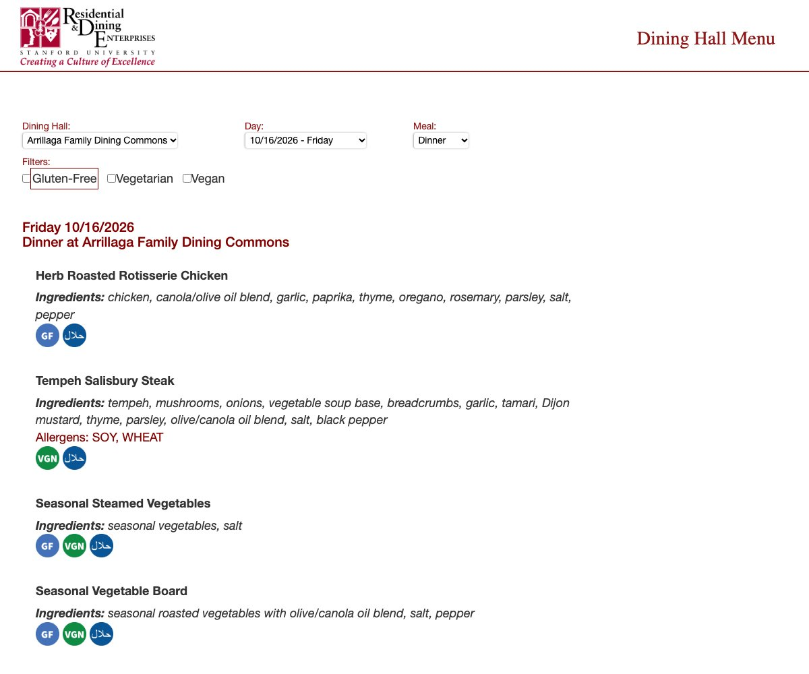
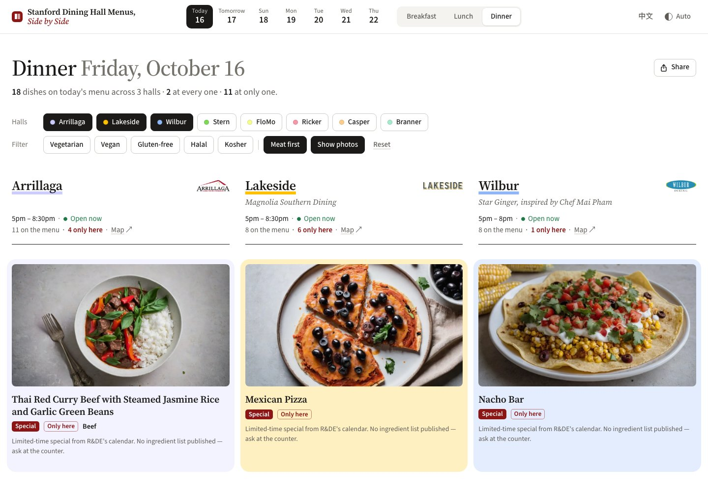

+++
date = '2026-10-19T00:00:00-07:00'
title = '怎么榨干 GitHub Actions'
description = '为了给斯坦福食堂菜单网站的每道菜配一张 AI 生成的图，又一分钱都不想花，我把 GitHub Actions 的免费机器当成了算力：没有显卡，就用 CPU 跑 SDXL，一张图十八分钟，那就每晚开十台一起画。'
keywords = ['GitHub Actions', '免费算力', 'Stable Diffusion', 'SDXL', 'RealVisXL', 'ComfyUI', 'CPU 生图', 'matrix', 'Stanford Dining', 'Side Project']
slug = 'squeeze-github-actions-dry'
translationKey = 'squeeze-github-actions-dry'
tags = ['GitHub Actions', 'Side Project', 'Automation', 'AI Image Generation']
draft = false

[cover]
image = 'cover.jpg'
relative = true
alt = "Stanford Dining Hall Menus, Side by Side：三家食堂的晚饭并排放，每家最上面是一道菜的图"
+++

从九月起，我开始去斯坦福的食堂吃饭。

去吃饭得先看菜单，但斯坦福官方给的菜单网站还停留在二十年前。一次只能查一家餐厅的一顿饭，如果想横向对比，就得重新点选下拉框。经常是看着后一家，上一家有什么已经忘了，又得点回去重选一遍。


*这就是斯坦福官方的菜单网站，[rdeapps.stanford.edu/dininghallmenu](https://rdeapps.stanford.edu/dininghallmenu/)。三个下拉框选完，出来一家食堂的一顿晚饭，这一家就有二十多道菜，一路往下滑。想看下一家？三个下拉框再来一遍。*

查个菜单不该这么麻烦。我的第一想法是写个脚本把每天的菜单抓下来，做成一个并排汇总的页面，一眼能看完今天吃什么，再决定去哪家。

第一版做起来很快：几家食堂的菜单并排摆开，今晚哪家有什么，一屏就能看完。正好我手上有现成的 neilmin.com 域名，挂个子域名上去，一分钱不用花，朋友也能用。于是就有了 [stanford-dining.neilmin.com](https://stanford-dining.neilmin.com)。


*同一天的晚饭，三家并排。*

做着做着又加了两样东西：中文翻译和菜品配图。食堂的英文菜名经常让人摸不着头脑，比如 “Craveable Grains”、“Magnolia Boil”，单看名字根本不知道是什么。所以我让 AI 根据菜名和配料表给每道菜画一张图，看一眼就知道是炖的还是炒的，是一整块肉还是切片的。

## 让网站自己跑起来

第一版有个硬伤：每天都得我手动维护。本地抓菜单、本地给新菜跑图、提交到 GitHub，再等它部署。

一个号称自动更新的网站，背后全靠人工手动跑，显然不是长久之计。手动撑一周还行，一个月也勉强，时间长了肯定维持不下去，所以必须自动化。

抓菜单的过程其实挺折腾。斯坦福这个网站是老旧的 ASP.NET 架构，没法直接拼个 URL 去请求“Wilbur 周五晚餐”，每次请求都必须带上上一次页面返回的一长串隐藏状态参数，而且每次都在变，只能一个接一个按顺序发。麻烦归麻烦，但说到底是个单纯的工程问题，搞定以后扔进 GitHub Actions 每天定时跑就行。

真正麻烦的是生图。

## 生图要算力，可我不想花钱

生图非常消耗算力。在我自己的笔记本上，用本地模型（RealVisXL，一个 SDXL 系的写实模型）生成一张图要一分半，效果很好。但如果要自动化，任务就得搬到云上跑，而云端需要算力。

花钱租个 GPU？我压根没考虑过，一个月五美元都不想花。这本来就是个顺手做的小项目，核心目标就是让它自己跑起来，而且一分钱不花。

那就只能找免费方案。

网上直接搜图行不通。菜名很多是食堂自己起的，搜出来的图经常对不上号，有版权风险，质量也参差不齐。后来我找到了 Cloudflare 的 Workers AI，每天有免费额度，上面有现成的云端生图模型，不用开我自己的电脑。

我们在 Cloudflare 上试过三个生图模型：SDXL-Lightning、FLUX.1 schnell 和 FLUX.2 klein。结果画出来的效果如下。左边是 Cloudflare 上的模型画的，右边是我本地 RealVisXL 画的。

下面两组，左边是 SDXL-Lightning：


*Meat Lover's Pizza，肉食者披萨*


*Beef Hot Dog，牛肉热狗*

下面两组，左边是 FLUX.1 schnell：


*Grilled Pineapple，烤菠萝*


*Corn Dogs，玉米热狗*

这些生成出来的图，要么涂抹感非常严重，要么就是有一些 AI 生图天生的缺陷，总会有一些不合逻辑的地方。总之就是没法使用。中间试过的 FLUX.2 klein 效果也差不多。

为了拦住这种低质图，我加了一道校验：生成后让另一个视觉模型看一眼，不对就重画。想法挺好，但免费额度本来就有限，一道菜经常要重试好几遍，画一张扣一次，检查一张又扣一次，额度很快就见底了。额度一旦用完，后面的检查流程也直接停摆。

来回折腾了几轮，我算是想明白了：效果最好的依然是我笔记本上这套模型。模型不用换，我唯一缺的，是一个能免费跑它的环境。

## GitHub Actions 也能当算力用

于是我想到了 GitHub Actions。

平时大家用 Actions，无非是代码推送后自动跑跑测试、打个包部署。但它的本质其实很简单：GitHub 借你一台 Linux 虚机，按你写好的步骤执行，跑完回收。跑测试是一组命令，生图其实也是一组命令。

而且公开仓库的 Actions 是完全免费的，不限使用时长。官方文档里标明的免费机器配置如下：

| | 公开仓库的免费机器 |
|---|---|
| CPU | 4 核 |
| 内存 | 16 GB |
| 硬盘 | 14 GB SSD |
| 显卡 | 没有 |
| 单个任务最长 | 6 小时 |
| 同时能跑 | 20 个任务（免费账号） |

没有显卡。如果纯用 CPU 跑 SDXL，画一张图要 17 到 19 分钟，比本地慢十几倍。这个方案我最早也考虑过，当时看到这个速度，第一反应就觉得不可行，直接排除了。

直到后来某天我突然反应过来：我当时只算了单台机器画一张要多久，没算能同时开几台。

一台 18 分钟出一张，那我就开十台一起画。每台跑四个小时，十台一晚上理论上能画一百多张。而食堂每天新出的菜一般也就十几二十道，这个吞吐量完全够用。

Actions 在我印象里一直是做 CI/CD 的工具，从来没想过还能直接拿来当分布式算力用。

## 把生图搬到 Actions 上

思路有了，真正在 Actions 上跑起来时还是遇到了不少细节问题。

首先是硬盘空间。RealVisXL 的模型文件接近 7 GB，而虚拟机的硬盘一共才 14 GB，还被 GitHub 预装的软件占去不少。.NET、Android SDK、Haskell 我都用不上，开机第一件事就是写脚本把它们删掉，给模型腾地方。接着安装 CPU 版的 PyTorch 和 ComfyUI。ComfyUI 锁定在与我本地一致的版本，确保云端生成的图片效果和本地完全一致。另外，每次从 Hugging Face 下载模型太慢，我把模型放进了 Actions 的缓存里，每晚都跑，缓存基本一直是热的。

其次是内存压力。模型跑起来会占用 15.3 GB 内存，总共才 16 GB，已经濒临上限。既然没有多余空间，一台机器就只能严格串行，一次只画一张。

再就是速度调优。既然慢，就得找地方省时间。我把不同参数生成的图片放一起肉眼对比，发现把步数从 20 降到 12，画面肉眼几乎看不出差别，CPU 时间却省了整整五分之二。分辨率则不能降，1024×576 和 1344×768 对比，前者细节明显逊色，所以依旧保持 1344×768。

还有成图质量。RealVisXL 底子虽然好，但偶尔也会画偏。因此我加了一层审核：每画完一张，让多模态模型判断几个是非题，比如“这到底是不是一根裹着面糊的香肠？”只要答错就重画。实在画不准的菜先空着，留到第二天晚上再试。

最后是任务拆分。整个工作流分为三步：

```text
菜单抓取跑完
    │
    ▼
plan：统计新菜数量，计算需要启动几台机器
    │
    ├──► 机器 1：画 2 道菜，AI 审图
    ├──► 机器 2：画 2 道菜，AI 审图
    │    ……
    └──► 机器 10：画 2 道菜，AI 审图
    │
    ▼
collect：拉取所有机器生成的图片，合并并提交
    │
    ▼
网站重新构建、部署
```

中间的并行生图用的是 Actions 的矩阵（matrix）特性。这个功能原本是用来在不同 Python 版本下并发跑测试的，我拿来做任务分发：`plan` 算出需要几台机器，矩阵就起几个并行 job，每台认领一部分。

分配时要控制每台机器的工作量。单个任务最长只能跑 6 小时，超时会被 GitHub 强制终止，未提交的图片就丢失了。因此每台机器只分两道菜，运行满 4 小时就不再接新任务，确保所有图片都能在有效时间内完成并提交。

到这里，整套自动化流程就理顺了。每次菜单抓取完毕，系统会自动统计新菜、启动机器、生图、审核并部署上线，平时不需要人工干预。

## Actions 的几个小坑

过程中遇到了几个细节问题，供参考：

- 定时任务不准时。配置的触发时间经常会延迟几个小时才开始跑，整点和半点排队最严重，建议错开这些时间。
- Actions 内部推送的 commit 默认不会触发 `on: push`。这是 GitHub 为防止死循环特意设计的机制。因此抓取完菜单如果想自动部署，需要在工作流里直接调用部署工作流。
- 被调用的工作流拉取的代码可能是旧的。它默认 checkout 的是触发时刻的代码，上一步刚推上去的改动可能拉不到，需要显式指定 `ref: main`。

## 这么用合规吗？

可能会有人疑问：这算不算滥用 Actions 当免费服务器？

GitHub 的使用条款规定，Actions 不能用于挖矿、当 CDN 或 serverless 后端，也不能运行与仓库本身无关的任务。我们这种用法属于合规边缘的合理使用：所有计算生成的图片都是本网站的核心静态资产，最终提交到本仓库并随网站一起发布，完全属于项目的构建与发布流程。

## 不花钱的代价

零成本的代价主要有两个：

一是延迟高。单张图要跑十几分钟，一道新菜从写入菜单到配上图需要几小时。不过食堂菜单通常会提前一周公布，等到菜品正式供应时，图片早就生成好了。从数据来看，10 月以来新增的 409 道菜里，有 406 道在供应当天或之前就已经有了配图。

二是并发受限。机器数量、运行上限和并发任务数都是锁死的，不可能一次性批量重画上千道菜。如果遇到开学第一周这种集中出现大量新菜的情况，我就在本地笔记本上跑，一分半一张，很快就能处理完。

对于一个食堂菜单网站来说，这两个限制完全在可接受范围内。

## 上线一个月，五百多人用过

网站上线一个月，累计有五百多人访问过，目前每天有五六十人使用。



最近一周的访问用户里，大约七成是回访用户，说明它确实成了一部分人每天查菜单的常用工具。我很高兴。

能在看食堂菜单这件事上给大家做了一点微小的工作，这个项目就算没白折腾。

整个项目的抓取代码、生图逻辑和完整的 GitHub Actions workflow 都在 GitHub 上开源：[NeilMin/better-stanford-dining-menu](https://github.com/NeilMin/better-stanford-dining-menu)，欢迎去瞅瞅或者给个 Star。
